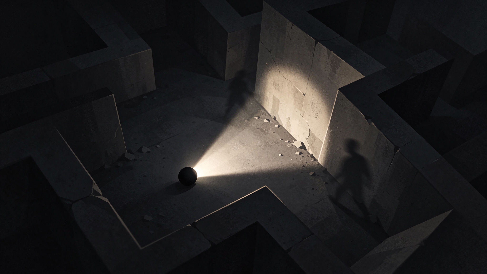

# AI 项目一 · 光圈之外

一个俯视视角的黑暗迷宫恐怖小游戏。你是一颗小黑球，只有手电筒照亮身边一小圈，在几乎全黑的水泥迷宫里摸索出口 —— 而偶尔，会有东西从光圈之外蹭过去。

## 在线玩

**https://abcqpwo.github.io/circle-of-light/**

（也可以直接下载 `index.html`，双击就能玩，不需要联网。）

## 操作

- **WASD / 方向键** 移动，手电方向跟随移动方向
- **手机 / 触屏**：按住屏幕拖动虚拟摇杆
- 找到嵌在墙里、门缝亮着两盏暗红呼吸灯的铁门，走进去就逃脱了
- 移动时手电会轻微晃动，光边会有明暗呼吸

## 玩法说明

- 迷宫每局随机生成，出口固定在离起点最远的位置，所以一定有路
- 手电只照亮前方一个锥形区域，外加身周一小圈微光，其余全是黑
- 每隔十几秒会有一道影子贴着光圈边缘掠过，那一瞬间光会被「吃掉」一块
- 掠过次数累积多了，它就不再只是路过 —— 会开始朝你靠近，贴得太近就会被抓住

## 技术

单文件 HTML + Canvas 2D，无第三方库、无构建步骤、无联网依赖。

- 光照用真射线可见性计算，墙体遮挡光锥，不是简单的圆形渐变
- 黑暗层用离屏画布做遮罩，光锥之外的区域被纯黑覆盖
- 迷宫为 21×21 格递归回溯生成，再打通若干环路，避免死路太多
- 结束面板显示用时、阴影掠过次数与最快记录（存 localStorage）

## 许可

个人项目，随便玩，随便改。
</output>
